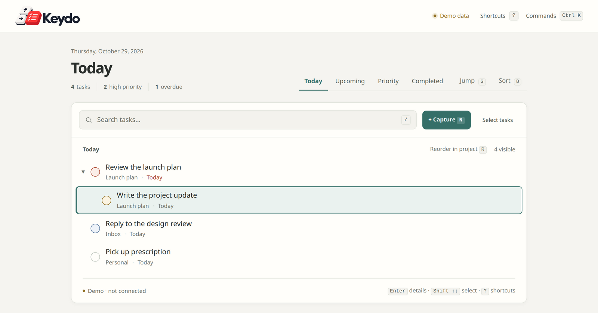

# Keydo

Keydo is a keyboard-first desktop workspace for [Todoist](https://www.todoist.com). Move through your tasks with the arrow keys and act on the selected one with a single key: complete, reschedule, reprioritise, move, nest or reorder it. Todoist stays the system of record. Keydo reads and writes your account directly and stores no task content of its own.



## What it does

- **One key per action.** `Space` completes, `T` / `Shift+T` move to Today / Tomorrow, `D` picks a date, `+` / `-` change priority, `M` moves to a project, `Delete` deletes. `Ctrl+K` opens a command palette, `G` jumps to any view or project, `/` searches everything, `?` lists every shortcut.
- **Actions keep your place.** Completing or moving a task leaves you in the same view, on the task that took its place, so a list can be worked top to bottom.
- **Details without dialogs.** `Enter` opens a task's notes, subtasks and images. Each section has its own key, and notes have a live Markdown preview.
- **Subtasks and structure.** Add, browse and drill into subtasks. In a project view, `Alt+Arrow` indents, outdents and reorders, and `Shift+M` moves a task under any parent.
- **Screenshots by paste.** Take a screenshot with your operating system's tool, select a task and press `Ctrl+V`. Keydo uploads it to Todoist as a task comment and shows it at full width in the task's details.
- **Fast and forgiving.** Changes appear instantly and sync to Todoist in the background. Failures roll back with a message. Reopening a parent also reopens the subtasks that were still open when you completed it.
- **Smart Add.** `N` captures a task with Todoist's natural-language parsing (`Call Alex tomorrow #Launch p1`).
- **Sorting.** `B` sorts the current view by due date, priority, title, project or date added. Sorting is a display choice and never changes order in Todoist.
- **Installable.** Served over HTTPS, Chrome can install Keydo as its own desktop app, with its own window and dock icon.

The full key map is in the [keyboard model](docs/keyboard-model.md).

## Status

Keydo is a personal project, built for one person's daily use on a Linux desktop, and shared as is. It works against a real Todoist account every day, but expect rough edges:

- **One user, no login.** Keydo has no accounts of its own. Anyone who can reach the server can use the Todoist account it is configured with, so keep it on your own machine or a private network such as a Tailscale tailnet. Never expose it to the internet.
- **Personal API token.** Keydo authenticates to Todoist with a personal API token. OAuth is planned but not built.
- **Desktop only.** It is designed for a keyboard and a desktop browser. Phone use is out of scope.
- **Workspaces.** In live mode all tasks appear in the Personal workspace. The Work workspace only exists in demo data.

## Getting started

Requires [Bun](https://bun.sh) 1.3 or later.

```bash
bun install
cp .env.example .env
bun run dev
```

Open `http://127.0.0.1:7710`. With no Todoist token set, Keydo runs in **demo mode** with sample tasks. Nothing leaves your machine, so it's a safe way to try the keyboard model.

To use your own tasks, copy your API token from Todoist (Settings → Integrations → Developer) into `TODOIST_ACCESS_TOKEN` in `.env` and restart. Keep `.env` private; Git ignores it. The token stays on the server and is never sent to the browser.

### Configuration

Bun loads `.env` automatically.

| Variable | Default | Purpose |
| --- | --- | --- |
| `TODOIST_ACCESS_TOKEN` | empty (demo mode) | Your Todoist personal API token |
| `PORT` | `7710` | Port to listen on |
| `HOST` | `127.0.0.1` | Address to bind to |
| `KEYDO_ALLOWED_HOSTS` | empty | Extra host names to accept, comma separated (see below) |
| `KEYDO_TRUST_TAILSCALE_SERVE` | `false` | Trust Tailscale Serve's forwarded headers; requires a loopback `HOST` |
| `KEYDO_RECOVERY_DB` | `data/completion-recovery.sqlite` | Where the completion-recovery journal is kept |
| `TODOIST_API_BASE` | `https://api.todoist.com` | Todoist API base URL |

The `TODOIST_CLIENT_*`, `TODOIST_REDIRECT_URI` and `TODOIST_SCOPES` entries in `.env.example` are reserved for OAuth and are not used yet.

The server only answers requests addressed to its bind address, loopback names, and the names in `KEYDO_ALLOWED_HOSTS`, which protects it from DNS rebinding. If you reach it through another host name, add that name.

The `data/` directory holds the completion-recovery journal: task IDs and timestamps only, no task content or credentials. Keep it across updates so reopening a completed parent can still restore its subtasks.

## Run it on a tailnet and install it as an app

[Tailscale](https://tailscale.com) makes Keydo reachable from your own devices only, and Tailscale Serve gives it the HTTPS address Chrome needs before it will install a site as an app.

1. Start Keydo with `bun run start:tailscale-https`. It binds to loopback, accepts the machine's Tailscale name, and trusts Tailscale Serve's forwarded headers, but only from loopback.
2. Once per machine, add a Serve entry for Keydo's port: `tailscale serve --bg --https=7710 http://127.0.0.1:7710`. Tailscale may ask for `sudo` if other Serve entries share folders.
3. Open `https://<machine>.<tailnet>.ts.net:7710` in Chrome (or another Chromium-based browser), then choose menu → *Cast, save and share* → *Install Keydo*. Pin it to your dock.

Always give `--https=<port>` explicitly. Plain `tailscale serve --bg 7710` takes over port 443, which may already be in use, or public if you use Funnel there. Never turn on Funnel for Keydo.

Settings such as the last view and each view's sort are stored in the browser per address, so they start fresh the first time Keydo opens at a new URL.

For plain HTTP on the machine's Tailscale IP instead, run `bun run start:tailscale` and open `http://<machine>.<tailnet>.ts.net:7710`. Chrome won't install Keydo from a plain HTTP address.

To keep Keydo running, run either script from a systemd user service (or your system's equivalent).

## How it works

A small Bun server (`src/server.ts`) holds the Todoist token and talks to Todoist's Sync and REST APIs. The interface is a single page (`index.html`) with logic split into modules under `src/`. The browser applies changes optimistically and syncs incrementally. A shared lock keeps tabs and devices from overlapping writes.

See the [architecture](docs/architecture.md) for the details: sync, ordering, locking, completion recovery and the security boundary.

## Development

```bash
bun test               # unit tests
bun run typecheck      # TypeScript, plus a check of the inline page script
bun run test:browser   # Playwright suites against a demo server
```

The browser suites need Chrome or Chromium; set `KEYDO_TEST_BROWSER` to its executable if it isn't on your `PATH`. They run against an isolated demo server or a fake Todoist upstream and never touch live credentials. Screenshots go to a temporary directory, or to `KEYDO_BROWSER_ARTIFACTS` if set.

## Documentation

- [Keyboard model](docs/keyboard-model.md): every binding, and where the cursor lands after each action
- [Architecture](docs/architecture.md): how Keydo is built
- [Decision log](docs/decision-log.md): product and technical decisions, and why
- [Todoist notes](docs/todoist-capabilities.md): the Todoist features, plan limits and APIs Keydo relies on

## License

[Apache License 2.0](LICENSE). Keydo is not affiliated with or endorsed by Doist, the maker of Todoist.
